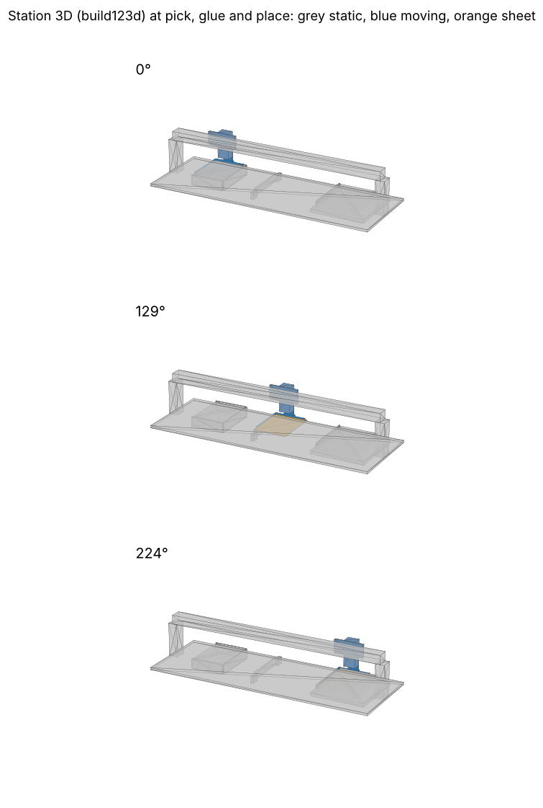
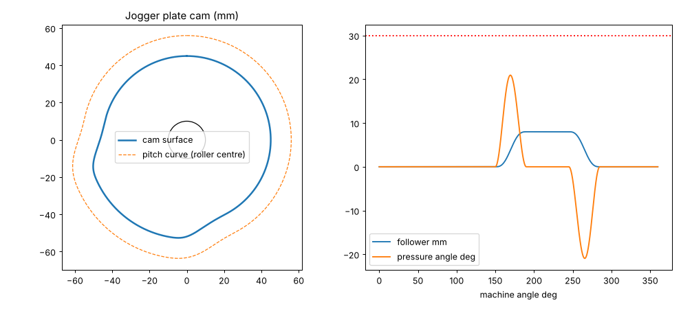

# Machine Design Framework (MDF)

A framework for designing industrial machines (special-purpose production machinery such as
bindery and finishing equipment) with **Claude as the design team** and a **human as chief engineer**.

It covers requirements, timing, mechanical layout, controls, electrical, safety, physical test plans and
verification. All of it is kept as text in git, and deterministic checks run on every change, so the design
is judged by physics and geometry rather than by an AI's confidence.

> **Any Claude reading this: start with [`CLAUDE.md`](CLAUDE.md).** It holds the operating rules.

## Why

An AI reasoning about a machine in its head produces confident, plausible mistakes: the product placed
6 mm off register, glue fired into the air, a vacuum released while the carrier is still moving, motion
that only works at one speed. MDF fixes this structurally:

1. **Process before machine.** Product states, ports and tolerances come first.
2. **The cycle diagram is the master.** Every axis and valve is a function of machine angle, in one file.
3. **Everything is text or code**, so Claude can work on all of it.
4. **Checks judge the design**, at min/nominal/max speed. Fix the design, never the check.
5. **Every assumption names the cheap physical test** that will replace it, and holdout tests validate predictions.
6. **Catalog parts first.** Deterministic, operator-proof processes.
7. **The human passes every gate.** An independent reviewer agent reports first.

Read [`docs/PHILOSOPHY.md`](docs/PHILOSOPHY.md) for the reasoning.

## Quick start

```bash
pip install -r requirements.txt
make verify          # example station: PASS (physical tests still pending)
make verify-broken   # deliberately broken copy with 15 planted faults: must FAIL and name every one
make hooks           # once per clone: install the claim-contract pre-commit hook
make plc P=<dir>     # regenerate PLC timing/I-O variable lists after changing cycle.yaml / io_list.yaml
make lock P=<dir>    # chief engineer only: approve the current check definitions
PYTHONPATH=tools python3 -m mdf verify <dir> --gate G3   # enforce what detailed design requires
```

Output: a console verdict, `build/report.md` (checks, traceability, assumption audit), `build/side_view.svg`,
`build/station_3d.png`, and `build/station.step` / `station.glb` (open in any STEP viewer).




*Example station: pick an endsheet from a stack, pass it over a glue jet, place it on a
signature. Carrier and sheet at pick (blue), glue (orange) and place (green); dashed line is the carrier path.*

## What's verified today

| Layer | Checks |
|---|---|
| Motion | Cam-law continuity, drive limits, valve timing at min/nom/max speed |
| Geometry | **3D** interference/clearance sweep over the full cycle (build123d + FCL); planar sweep with the **flexible sheet** |
| Product | Pick, carry (slip), place on register, glue bead position and gap |
| Sheet physics | Overhang droop/oscillation (FE beam: gravity, Z acceleration, air drag) fed into geometry and glue checks |
| BOM | Interface conflicts between connected parts; params vs datasheets; **servo sizing** (peak/RMS torque, rpm, inertia); air and 24 V budgets; sim assumptions vs datasheet |
| Electrical | I/O channels, voltage/current vs card ratings, safety devices on safety inputs |
| PLC | Generated timing/I-O lists in sync; the **real Structured Text program** run scan-by-scan against the plant with fault injection (missed pick, empty stack, double sheet, guard, e-stop, air loss) |
| Trace | Every requirement verified by a check, test or review; every PASS lists the unmeasured numbers it rests on |
| Cams | Mechanical plate cams designed from the same motion law: pressure angle, undercut, Hertz, follower jump, roller life, camshaft torque; DXF/STEP export |
| Tolerances | Worst case, RSS and Monte Carlo stack-ups with the biggest contributors ranked |
| Safety / reliability | ISO 13849-1 risk graph bookkeeping, safety functions validated by SIL scenarios; FMEA with action thresholds |
| Integrity | Claim contract (no commit on stale or failed verify), check lock (no silent weakening of checks), CAD kernel assertions |
| Fidelity | Every part/number marked estimate → datasheet → vendor STEP → measured, with sources; unknowns reported as NOT VERIFIED; a ranked **human action queue** (download, look up, test, review, quote) on every run |

See [`docs/VERIFICATION.md`](docs/VERIFICATION.md) for the trust ladder and what **no** check covers.

## Model tiers

Tasks are labelled **TIER-A** (Claude Fable 5.2: process, cycle design, spatial debugging, gate review) or
**TIER-B** (Claude Opus 5.5: specified CAD, BOMs, drawings, PLC code to an approved spec, fix loops).
Claude prints a switch banner when it is on the wrong model. See [`docs/MODEL_TIERS.md`](docs/MODEL_TIERS.md).

## Map

| Path | What |
|---|---|
| [`CLAUDE.md`](CLAUDE.md) | Operating rules for Claude |
| [`docs/PHILOSOPHY.md`](docs/PHILOSOPHY.md) | Principles |
| [`docs/WORKFLOW.md`](docs/WORKFLOW.md) | Phases, gates G0-G5, working session, repo layout for a real machine |
| [`docs/MODEL_TIERS.md`](docs/MODEL_TIERS.md) | Which model for which task |
| [`docs/VERIFICATION.md`](docs/VERIFICATION.md) | What the checks prove and don't |
| [`docs/PRIOR_ART.md`](docs/PRIOR_ART.md) | What others tried, how AI design fails, and the countermeasures here |
| [`docs/ACTUATION.md`](docs/ACTUATION.md) | Cam > servo > pneumatic: why, and where to push back |
| [`templates/SPEC_CHECKLIST.md`](templates/SPEC_CHECKLIST.md) | Spec intake checklist (start here for a new machine) |
| [`docs/FIDELITY.md`](docs/FIDELITY.md) | Fidelity ladder, human action queue, gate enforcement |
| [`docs/ANALOGY.md`](docs/ANALOGY.md) | Where the software analogy holds and where it breaks |
| [`docs/PHYSICAL_TESTS.md`](docs/PHYSICAL_TESTS.md) | Cheap real-world tests, calibration loop |
| [`docs/TOOLCHAIN.md`](docs/TOOLCHAIN.md) | Tools, viewers, SEW MOVISUITE, bench controller, paid options |
| [`docs/REQUIREMENTS.md`](docs/REQUIREMENTS.md) | Requirements for the framework itself, with status |
| [`docs/INDUSTRY_PRACTICE.md`](docs/INDUSTRY_PRACTICE.md) | Standards and practices it borrows from |
| `schemas/` | JSON schemas for every project file |
| `.claude/skills/` | Discipline skills: process, cycle, mechanical, drawings/DFM, controls, electrical, safety, physical tests |
| `.claude/agents/gate-reviewer.md` | Independent reviewer subagent |
| `tools/mdf/` | Verification toolchain |
| `examples/` | Passing example (with `cad/`, `plc/`, BOM, I/O, SIL scenarios) and deliberately broken copy (`FAULTS.md`) |
| `templates/` | How to start a new station |

## Starting a new machine

1. Give Claude the spec document; it runs the `mdf-intake` skill: sourced, quantified requirements and a list of questions.
2. `PYTHONPATH=tools python3 -m mdf new machines/<machine>/stations/<station>` scaffolds a station project.
3. Work through `docs/WORKFLOW.md` gates; `make verify` after every change; the action queue says what a human needs to do.



## The example's parts

Drive train and vacuum are real catalog parts with datasheet links (Festo ELGA-TB-G-80 belt axis and EGSL-45
slide, SEW CM3C63L and CMP40M servomotors, Schmalz SCPMc 10 ejector). The rest are flagged estimates in the
action queue. Swapping in the real parts broke two example assumptions (axis acceleration, vacuum build time);
both were fixed in the design. See the commit history.

## Disclaimer

MDF helps design machines. It does not make them safe. Machine safety, guarding and electrical compliance
need review and sign-off by a qualified person under the applicable standards (ISO 12100, ISO 13849,
IEC 60204-1/NFPA 79, OSHA/ANSI B11). The example station is illustrative, not a production design.
