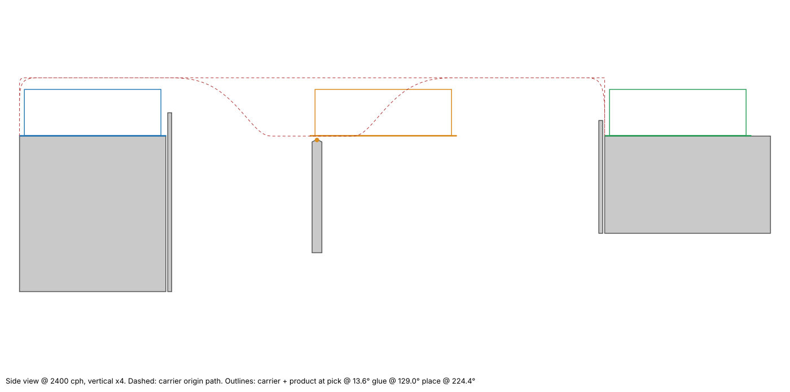

# Machine Design Framework (MDF)

A framework for designing industrial machines (special-purpose production machinery such as
bindery and finishing equipment) with **Claude as the design team** and a **human as chief engineer**.

It covers requirements, timing, mechanical layout, controls, electrical, safety, physical test plans and
verification. All of it is kept as text in git, and deterministic checks run on every change, so the design
is judged by physics and geometry rather than by an AI's confidence.

> **Any Claude reading this: start with [`CLAUDE.md`](CLAUDE.md).** It holds the operating rules.

## Why

An AI reasoning about a machine in its head produces confident, plausible mistakes: the product placed
6 mm off register, glue fired into the air, a vacuum released while the carrier is still moving, motion
that only works at one speed. MDF fixes this structurally:

1. **Process before machine.** Product states, ports and tolerances come first.
2. **The cycle diagram is the master.** Every axis and valve is a function of machine angle, in one file.
3. **Everything is text or code**, so Claude can work on all of it.
4. **Checks judge the design**, at min/nominal/max speed. Fix the design, never the check.
5. **Every assumption names the cheap physical test** that will replace it, and holdout tests validate predictions.
6. **Catalog parts first.** Deterministic, operator-proof processes.
7. **The human passes every gate.** An independent reviewer agent reports first.

Read [`docs/PHILOSOPHY.md`](docs/PHILOSOPHY.md) for the reasoning.

## Quick start

```bash
pip install -r requirements.txt
make verify          # example station: should PASS (with physical tests still pending)
make verify-broken   # deliberately broken copy: must FAIL, showing every planted mistake caught
```

Output: a console verdict, `build/report.md` (checks, traceability, assumption audit) and `build/side_view.svg`.



*Example station (illustrative): pick an endsheet from a stack, pass it over a glue jet, place it on a
signature. Carrier and sheet at pick (blue), glue (orange) and place (green); dashed line is the carrier path.*

## What's verified today

| Check | Proves |
|---|---|
| CYC-LAW | Motion covers the full cycle; position and velocity are continuous (no impossible accelerations) |
| CYC-LIMITS | Peak velocity/acceleration within catalog drive limits at max speed |
| VALVE-TIMING | Effective valve windows including response delay, at every speed |
| SWEEP-CLEARANCE | No interference, and minimum clearances, over the whole cycle (planar side view) |
| PROD-PICK / CARRY / PLACE | The product is gripped before leaving, held through transfer without slipping, and released at rest on register |
| GLUE-BEAD | Glue lands on the product, in the right place, at the right gap, at every speed |
| Traceability | Every requirement verified by a check, a physical test or a review |
| Assumption audit | Lists exactly which unmeasured numbers every PASS depends on |

Roadmap: 3D interference on code-CAD, tolerance stacks, PLC software-in-the-loop, flexible-body dynamics.
See [`docs/VERIFICATION.md`](docs/VERIFICATION.md) for the trust ladder and what **no** check covers.

## Model tiers

Tasks are labelled **TIER-A** (Claude Fable 5.2: process, cycle design, spatial debugging, gate review) or
**TIER-B** (Claude Opus 5.5: specified CAD, BOMs, drawings, PLC code to an approved spec, fix loops).
Claude prints a switch banner when it is on the wrong model. See [`docs/MODEL_TIERS.md`](docs/MODEL_TIERS.md).

## Map

| Path | What |
|---|---|
| [`CLAUDE.md`](CLAUDE.md) | Operating rules for Claude |
| [`docs/PHILOSOPHY.md`](docs/PHILOSOPHY.md) | Principles |
| [`docs/WORKFLOW.md`](docs/WORKFLOW.md) | Phases, gates G0-G5, working session, repo layout for a real machine |
| [`docs/MODEL_TIERS.md`](docs/MODEL_TIERS.md) | Which model for which task |
| [`docs/VERIFICATION.md`](docs/VERIFICATION.md) | What the checks prove and don't |
| [`docs/PHYSICAL_TESTS.md`](docs/PHYSICAL_TESTS.md) | Cheap real-world tests, calibration loop |
| [`docs/TOOLCHAIN.md`](docs/TOOLCHAIN.md) | Tools, viewers, SEW MOVISUITE, bench controller, paid options |
| [`docs/REQUIREMENTS.md`](docs/REQUIREMENTS.md) | Requirements for the framework itself, with status |
| [`docs/INDUSTRY_PRACTICE.md`](docs/INDUSTRY_PRACTICE.md) | Standards and practices it borrows from |
| `schemas/` | JSON schemas for every project file |
| `.claude/skills/` | Discipline skills: process, cycle, mechanical, drawings/DFM, controls, electrical, safety, physical tests |
| `.claude/agents/gate-reviewer.md` | Independent reviewer subagent |
| `tools/mdf/` | Verification toolchain |
| `examples/` | Passing example and deliberately broken copy |
| `templates/` | How to start a new station |

## Disclaimer

MDF helps design machines. It does not make them safe. Machine safety, guarding and electrical compliance
need review and sign-off by a qualified person under the applicable standards (ISO 12100, ISO 13849,
IEC 60204-1/NFPA 79, OSHA/ANSI B11). The example station is illustrative, not a production design.
